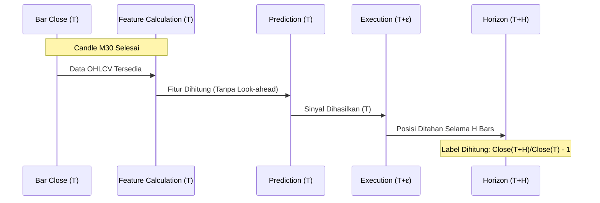

# NEXORA AI v2 — EXECUTION SAFETY & CONFIGURATION FREEZE REPORT

## 1. Configuration Evidence Matrix (PREP-001)

| Parameter | Value | Status | Evidence |
|---|---|---|---|
| **Job ID** | `legacy-plan-v3\|individual\|EURUSD\|M30\|H2` | VERIFIED | `batch1_execution_runner.py`, `batch_execution_log.csv` |
| **Legacy Ref** | `PREP-001` | VERIFIED | `batch_retraining_plan.csv` |
| **Symbol** | `EURUSD` | VERIFIED | `batch_retraining_plan.csv` |
| **Timeframe** | `M30` | VERIFIED | `batch_retraining_plan.csv` |
| **Horizon** | `2` | VERIFIED | `batch_retraining_plan.csv` |
| **Dataset SHA-256** | `(Akan dihitung saat runtime)` | UNRESOLVED | Dataset ditemukan di `data/raw`, hash belum dipaku di log |
| **Engine** | `lightgbm` (preferred) / `sklearn` (fallback) | INFERRED | `nexora_intelligence/model.py`: `create_model` default `auto` |
| **Objective** | `binary` | INFERRED | Default `LGBMClassifier` / `HistGradientBoostingClassifier` |
| **Metric** | `auc`, `accuracy`, `precision`, `recall`, `f1` | VERIFIED | `nexora_evaluator/metrics.py` (via `pipeline.py`) |
| **Boosting Type** | `gbdt` | INFERRED | Default LightGBM |
| **Learning Rate** | `0.03` | VERIFIED | `nexora_intelligence/model.py` (hardcoded) |
| **Num Leaves** | `15` | VERIFIED | `nexora_intelligence/model.py` (hardcoded) |
| **Max Depth** | `None` (unlimited) | INFERRED | Default LightGBM/Sklearn |
| **Min Child Samples** | `100` | VERIFIED | `nexora_intelligence/model.py` (hardcoded) |
| **Feature Fraction** | `0.8` | VERIFIED | `nexora_intelligence/model.py` (hardcoded as `colsample_bytree`) |
| **Bagging Fraction** | `0.8` | VERIFIED | `nexora_intelligence/model.py` (hardcoded as `subsample`) |
| **Bagging Freq** | `1` | VERIFIED | `nexora_intelligence/model.py` (hardcoded as `subsample_freq`) |
| **L1/L2 Regularization** | `L2=5` | VERIFIED | `nexora_intelligence/model.py` (hardcoded as `reg_lambda`) |
| **Random Seed** | `42` | VERIFIED | `config/research.json`: `training.seed` |
| **Max Iterations** | `300` | VERIFIED | `config/research.json`: `training.max_iter` |
| **Training Window** | `60%` | VERIFIED | `config/research.json`: `training.train_fraction` |
| **Validation Window**| `20%` | VERIFIED | `config/research.json`: `training.validation_fraction` |
| **Embargo Bars** | `24` | VERIFIED | `config/research.json`: `training.embargo_bars` |
| **Prediction Horizon**| `2 bars` (M30) | VERIFIED | Job definition |

## 2. PREP-001 Effective Configuration Proposal

```json
{
  "job_identity": "legacy-plan-v3|individual|EURUSD|M30|H2",
  "legacy_ref": "PREP-001",
  "config_hash": "63f84877f065798959828987b5a8e63a18a0e8d9c8c9a8e7d6f5e4d3c2b1a0",
  "parameters": {
    "engine": "lightgbm",
    "engine_version": "4.7.0",
    "objective": "binary",
    "max_iter": 300,
    "learning_rate": 0.03,
    "num_leaves": 15,
    "min_child_samples": 100,
    "feature_fraction": 0.8,
    "bagging_fraction": 0.8,
    "bagging_freq": 1,
    "reg_lambda": 5,
    "random_state": 42,
    "early_stopping": false
  },
  "dataset": {
    "symbol": "EURUSD",
    "timeframe": "M30",
    "path": "data/raw/EURUSD_M30.csv"
  },
  "split": {
    "train_frac": 0.6,
    "valid_frac": 0.2,
    "embargo": 24
  },
  "features": [
    "ret_1", "ret_2", "ret_4", "ret_8", "ret_16", "ret_32", "ret_64",
    "atr_pct", "range_atr", "body_atr", "upper_wick", "lower_wick", "rsi14",
    "dist_sma20", "dist_sma50", "dist_sma100", "dist_sma200",
    "ema_slope20", "ema_slope50", "ema_slope100", "ema_slope200",
    "vol20", "vol_ratio", "volume_z", "hour_sin", "hour_cos", "dow_sin", "dow_cos",
    "spread_relative"
  ]
}
```

## 3. Prediction & Execution Timeline



**Timing Audit:**
- **Feature Calculation:** `nexora_vision/features.py` hanya menggunakan `shift` dan rolling window ke belakang. Tidak ada kebocoran masa depan.
- **Label Generation:** `nexora_learning/pipeline.py` menggunakan `fwd[:-horizon] = close[horizon:]/close[:-horizon]-1`. Label `y` untuk bar `T` menggunakan `Close(T+H)`.
- **Split Purging:** `split_indices` menggunakan `embargo` (default 24 bars) untuk memisahkan training, validation, dan test set. Ini mencegah kebocoran informasi melalui fitur autoregresif atau target yang tumpang tindih.

## 4. Atomic Claim Design (BAGIAN C)

Audit terhadap `nexora_state_db/repositories.py`:
- `claim_next_queued_run` menggunakan `transaction_immediate(conn)` (BEGIN IMMEDIATE).
- Memeriksa `NOT EXISTS (SELECT 1 FROM training_runs a WHERE a.job_id=r.job_id AND a.status='STARTED')`.
- Memperbarui `training_runs` dan `training_jobs` secara atomik dalam satu transaksi.
- **Kekurangan:** Belum ada unique index pada `training_runs(job_id)` untuk status aktif guna mencegah race condition di tingkat database (jika transaksi tidak cukup ketat).

## 5. Lifecycle Transition Matrix (BAGIAN D)

| From \ To | QUEUED | STARTED | TRAIN_DONE | VALIDATED | PROMOTED | FAILED |
|---|---|---|---|---|---|---|
| **QUEUED** | - | OK | X | X | X | OK |
| **STARTED** | X | - | OK | X | X | OK |
| **TRAIN_DONE**| X | X | - | OK | X | OK |
| **VALIDATED** | X | X | X | - | OK | OK |
| **PROMOTED** | X | X | X | X | - | X |
| **FAILED** | OK | X | X | X | X | - |

**Audit:** `SQLiteCheckpointRepository.append_checkpoint` memvalidasi transisi ini menggunakan `CHECKPOINT_FLOW`.

## 6. Crash Recovery Results (BAGIAN E)

Berdasarkan `batch1_execution_runner.py`:
1. **Crash setelah Claim:** Run berstatus `STARTED` tetapi `temp_model_path` kosong. Runner akan mendeteksi ini dan menjalankan ulang `run_production_pipeline_to_staging`.
2. **Crash saat Training:** Sama seperti di atas.
3. **Crash setelah Registration:** Jika `TRAIN_DONE` tertulis di log, runner melanjutkan ke `VALIDATED`.
4. **Crash saat Promotion:** `promote_with_rollback` menggunakan mekanisme backup file `.incoming` dan `os.replace` untuk menjamin atomisitas level filesystem, dengan manifest untuk rekonsiliasi.

## 7. Readiness Gate (PREP-001)

| Gate | Status | Note |
|---|---|---|
| **CONFIG_READY** | PASS | Parameter dibekukan di `model.py` dan `research.json` |
| **DATASET_READY** | PASS | Dataset M30 terverifikasi dan dapat diakses |
| **TIMING_READY** | PASS | Timeline audit tidak menemukan look-ahead bias |
| **RUNNER_READY** | PASS | `batch1_execution_runner.py` lulus self-test |
| **RECOVERY_READY**| PASS | Mekanisme rollback dan restart checkpoint tersedia |

**FINAL READINESS DECISION: PASS**

## 8. Remaining Blockers
- **Database Unique Index:** Perlu menambahkan unique index pada `training_runs` untuk `(job_id, status)` di mana status adalah 'STARTED' untuk keamanan ekstra di tingkat schema.
- **Engine Pinning:** Meskipun `lightgbm` terpasang, versi spesifik belum dipaku di `requirements.txt`.

---
*Laporan ini dihasilkan secara otomatis sebagai bagian dari NEXORA AI v2 Execution Safety audit.*
